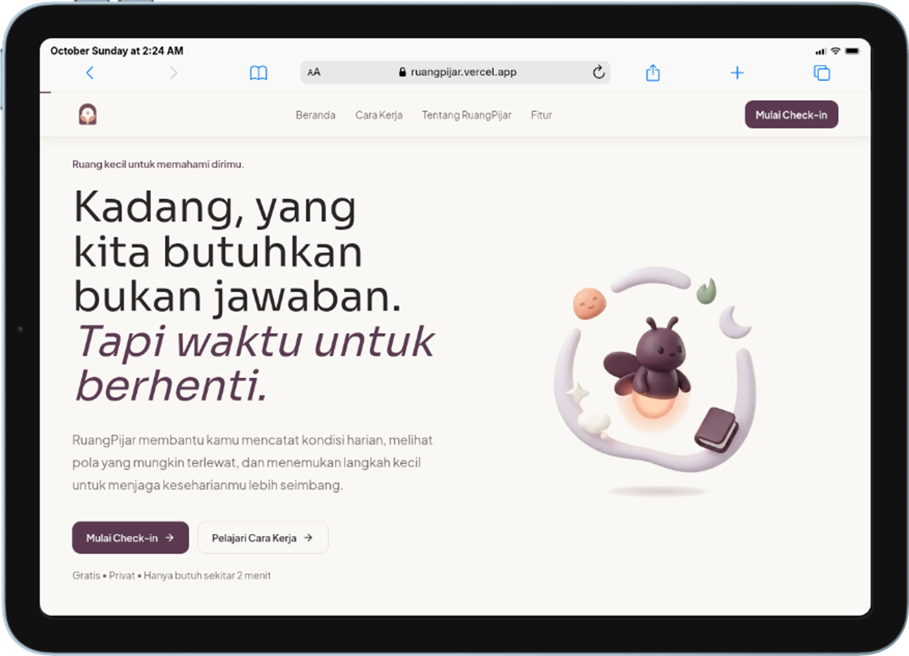
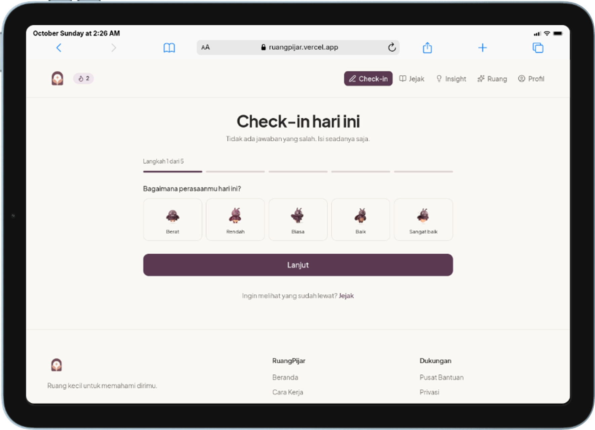
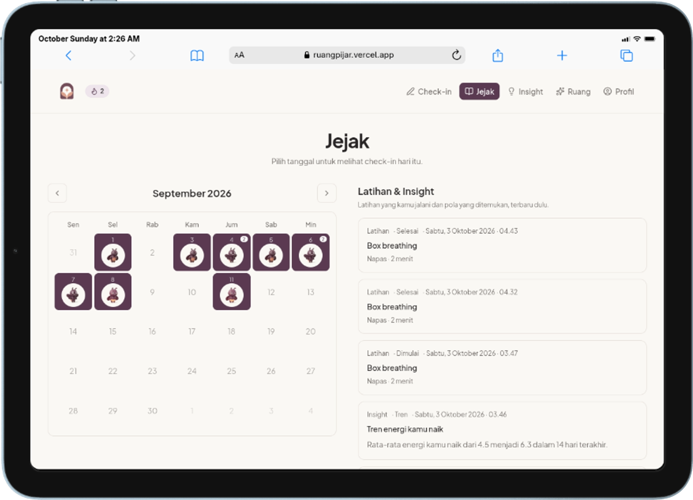
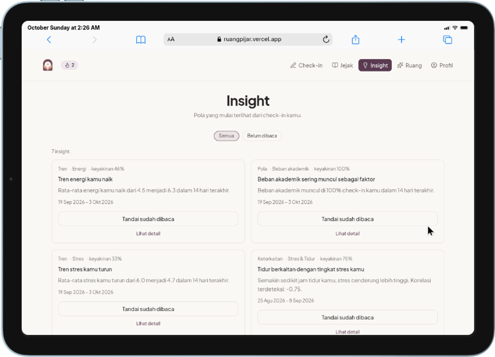
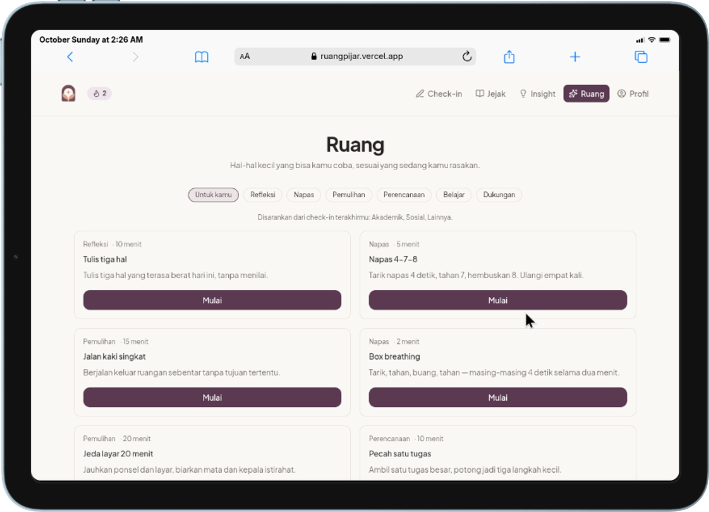
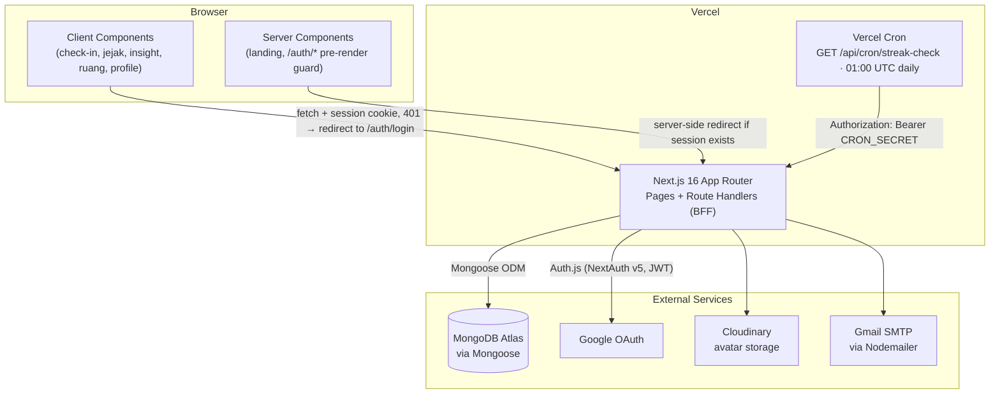

<div align="center">
  
  
  

  <h1>RuangPijar</h1>

  <p><em>"Kadang, yang kita butuhkan bukan jawaban. Tapi waktu untuk berhenti."</em><br/>
  "Sometimes what we need isn't an answer. It's time to stop."</p>

  <p>A calm, private self-reflection companion that helps students notice the daily patterns behind their mood, energy, and stress — one two-minute check-in at a time.</p>

  <p>
    
    
    
    
    
  </p>

  <p>
    <a href="https://ruangpijar.vercel.app"><strong>Live Demo</strong></a> ·
    <a href="docs/USER_JOURNEY.md">Technical User Journey</a> ·
    <a href="docs/openapi.json">OpenAPI Spec</a> ·
    <a href="#getting-started">Getting Started</a>
  </p>
</div>

---

## Table of Contents

1. [Project Overview](#project-overview)
2. [Background & Problem Statement](#background--problem-statement)
3. [Solution](#solution)
4. [Features](#features)
5. [Demo & Screenshots](#demo--screenshots)
6. [Technology Stack](#technology-stack)
7. [System Architecture](#system-architecture)
8. [Project Structure](#project-structure)
9. [Getting Started](#getting-started)
   - [Prerequisites](#prerequisites)
   - [Installation](#installation)
   - [Environment Variables](#environment-variables)
   - [Development Server](#development-server)
10. [Available Scripts](#available-scripts)
11. [Roadmap](#roadmap)
12. [Contributing](#contributing)
13. [License](#license)

---

## Project Overview

**RuangPijar** ("a little room to understand yourself") is a web application that helps people — university students in particular — notice the daily patterns behind their mood, energy, stress, sleep, and the factors that influence them. The experience is built around one repeating loop:

```
Check-in  →  Jejak  →  Insight  →  Ruang
(Record)     (Recall)   (Understand)   (Act)
   ↑___________________________________|
```

A user logs a short daily check-in, reviews their history on a calendar, asks the app to surface statistical patterns in their own data, and gets a few small, relevant coping exercises to try. The more consistently someone checks in, the more useful Insight and Ruang become.

RuangPijar was built for **MindCraft Web Competition 2026**, a regional (Java island) web-development competition organized by Himpunan Mahasiswa Informatika (HMIF), Universitas Jenderal Achmad Yani Yogyakarta, under the theme *"Building Digital Solutions, for Mental Well-being."*

> **Important framing:** RuangPijar is a self-reflection and journaling tool, **not** a diagnostic or clinical product, and it does not replace professional mental-health support. Every pattern it surfaces comes from simple, transparent statistics over the user's own check-ins — see [Solution](#solution) for exactly what that means.

## Background & Problem Statement

Mental well-being is a significant concern for university students, who face overlapping academic, social, and personal pressures while often having limited access to conventional mental-health services. Research on digital mental-health interventions for students backs up the potential of lightweight, web-based tools:

- A systematic review by Lattie et al. (2019) of 89 studies on digital mental-health interventions for college students found that **80% of the interventions studied were delivered via a website**, with most showing full or partial effectiveness in improving outcomes such as depression, anxiety, and psychological well-being — provided the tool is usable and well accepted by its users.
- Naslund et al. (2017) highlight that digital technology can help **expand access** to mental-health support, particularly where access to conventional services is limited.

This points to a concrete, buildable problem: students need an **accessible, informative, and genuinely usable** way to notice their own well-being patterns before things start to feel overwhelming — without requiring a clinical setting or specialized infrastructure.

## Solution

RuangPijar answers that problem with a deliberately small, honest toolset instead of a heavyweight clinical platform:

- **Low-friction daily logging.** A ~2-minute, 5-step check-in (mood, energy, stress, optional sleep/academic/social load, optional factors, optional free-text reflection) is the only data entry required to make the rest of the product work.
- **Statistics, not diagnosis.** Patterns ("Insight") are computed with plain, explainable arithmetic over the user's own recent check-ins — trend comparison, Pearson correlation, and frequency counting (see [`lib/insight-generator.ts`](lib/insight-generator.ts)). There is **no AI/ML/LLM and no blockchain/Web3 involved anywhere in the product**, despite an outdated line of marketing copy in `app/layout.tsx`'s page metadata that still claims otherwise — tracked as a documentation fix in the [Roadmap](#roadmap). The in-app copy and footer disclaimer are accurate: *"RuangPijar bukan layanan diagnosis atau pengganti bantuan profesional."* ("RuangPijar is not a diagnostic service or a substitute for professional help.")
- **User-triggered, not surveillance.** Insight generation only ever runs when the user presses "Cari pola baru" ("Find new patterns") — nothing is computed or pushed automatically in the background.
- **Small, actionable next steps.** "Ruang" turns the factors that show up most in recent check-ins into a short list of relevant coping exercises (breathing, short reflection prompts, task breakdown, etc.) instead of leaving the user with a chart and no next action.
- **Private by default.** Every query is scoped to the authenticated user (`{ _id, userId }`), and a user who tries to access someone else's record gets the same `404` as a record that doesn't exist — no data leaks through error responses.

## Features

### Core loop

| Step | Route | What it does |
|---|---|---|
| **Check-in** | `/check-in` | 5-step wizard logging mood (1–5), energy & stress (1–10), optional sleep hours / academic load / social load, up to 9 contributing factors, and a free-text reflection (≤2000 chars). Drives a daily streak with a celebratory popup on increase. |
| **Jejak** ("Trail") | `/jejak` | A monthly calendar showing one mood face per day (with a badge for multiple same-day check-ins) side-by-side with a combined, paginated feed of past exercises (from Ruang) and discovered patterns (from Insight). |
| **Insight** | `/insight` | Rule-based pattern detection, manually triggered. Looks at the last 14 days of check-ins and evaluates three independent candidate types — see [System Architecture](#system-architecture) for the exact thresholds. Each result ships with a confidence percentage and a read/unread state. |
| **Ruang** ("Room") | `/ruang` | A catalog of short coping exercises ("Latihan"). The default view recommends exercises whose `relatedFactors` overlap with the top factors from the user's last 5 check-ins; a type filter (Reflection, Breathing, Recovery, Planning, Learning, Support) browses the full catalog instead. Each exercise can be started, then marked completed or skipped. |

### Supporting features

- **Authentication** — email/password (bcrypt-hashed, 12 rounds) or Google OAuth via NextAuth (Auth.js) v5, with automatic account linking when a Google sign-in matches an existing email. Sessions use the JWT strategy.
- **Onboarding wizard** (`/onboarding`) — a 3-step personalization flow (focus areas, check-in frequency, preferred reminder time) shown after every login; answers are pre-filled from the previous run.
- **Streak & reminder emails** — a daily Vercel Cron job (`/api/cron/streak-check`, 01:00 UTC) resets streaks that have gone quiet for 3+ days and sends Nodemailer/Gmail reminder emails before that happens.
- **Profile** (`/profile`) — edit display name and avatar (Cloudinary upload with crop via `react-easy-crop`), update onboarding preferences, replay the guided tour, and sign out.
- **Guided product tour** — a `react-joyride`-powered spotlight tour per section (Check-in, Jejak, Insight, Ruang, Profile), shown once automatically and replayable anytime from Profile.
- **Interactive API reference** (`/docs`) — a [Scalar](https://scalar.com)-powered viewer rendering the hand-maintained OpenAPI 3 spec at [`docs/openapi.json`](docs/openapi.json) (16 documented path groups).

For the full behavioral spec of every feature — including documented edge cases and known gaps — see [`docs/USER_JOURNEY.md`](docs/USER_JOURNEY.md), which is written and kept up to date directly against the running code.

## Demo & Screenshots

**Live demo:** [ruangpijar.vercel.app](https://ruangpijar.vercel.app)

<table>
  <tr>
    <td width="50%">
      
      <p align="center"><sub><strong>Landing page</strong> — the product promise, stated plainly: "Sometimes what we need isn't an answer. It's time to stop."</sub></p>
    </td>
    <td width="50%">
      
      <p align="center"><sub><strong>Check-in</strong> — step 1 of the 5-step daily wizard, picking today's mood.</sub></p>
    </td>
  </tr>
  <tr>
    <td width="50%">
      
      <p align="center"><sub><strong>Jejak</strong> — monthly check-in calendar alongside a chronological feed of exercises and insights.</sub></p>
    </td>
    <td width="50%">
      
      <p align="center"><sub><strong>Insight</strong> — trend, correlation, and pattern cards, each with a confidence score.</sub></p>
    </td>
  </tr>
  <tr>
    <td width="50%">
      
      <p align="center"><sub><strong>Ruang</strong> — coping exercises recommended from the factors in recent check-ins.</sub></p>
    </td>
    <td width="50%" valign="middle" align="center">
      <sub>More flows (auth, onboarding, profile, detail pages) are covered step-by-step in <a href="docs/USER_JOURNEY.md">docs/USER_JOURNEY.md</a>.</sub>
    </td>
  </tr>
</table>

## Technology Stack

<p align="center">
  
  &nbsp;&nbsp;
  
  &nbsp;&nbsp;
  
  &nbsp;&nbsp;
  
  &nbsp;&nbsp;
  
  &nbsp;&nbsp;
  
  &nbsp;&nbsp;
  
  &nbsp;&nbsp;
  
</p>

The list below reflects what's actually declared in [`package.json`](package.json) — nothing aspirational.

| Category | Technology | Purpose |
|---|---|---|
| **Framework** | [Next.js 16](https://nextjs.org) (App Router) | Pages, layouts, and API route handlers (BFF) in one codebase |
| | [React 19](https://react.dev) | UI rendering (Server + Client Components) |
| | [TypeScript 5](https://www.typescriptlang.org) (strict mode) | Static typing across the app, `@/*` path alias to the repo root |
| **Styling** | [Tailwind CSS v4](https://tailwindcss.com) | Utility-first styling via `@tailwindcss/postcss` |
| | `next/font` + Google Fonts | Sora (display), Plus Jakarta Sans (body/UI), JetBrains Mono |
| **Animation** | [GSAP](https://gsap.com) + `@gsap/react` | Scroll-reveal and hero animations, respecting `prefers-reduced-motion` |
| **Auth** | [NextAuth.js (Auth.js) v5](https://authjs.dev) | Credentials + Google OAuth providers, JWT session strategy |
| | `bcryptjs` | Password hashing (12 rounds) |
| **Database** | [MongoDB](https://www.mongodb.com) (Atlas) | Primary data store |
| | [Mongoose 9](https://mongoosejs.com) | Schema definitions & ODM, connection caching in `lib/mongodb.ts` |
| **Media** | [Cloudinary](https://cloudinary.com) | Profile avatar storage/CDN |
| | `react-easy-crop` | In-browser avatar cropping before upload |
| **Email** | `nodemailer` | Streak reminder/reset emails over Gmail SMTP |
| **Onboarding UX** | `react-joyride` | Section-by-section guided spotlight tour |
| **Icons** | [Lucide React](https://lucide.dev) | Icon set used across the UI |
| **API Docs** | `@scalar/nextjs-api-reference` | Interactive API reference served at `/docs` from `docs/openapi.json` |
| **Tooling** | [Biome](https://biomejs.dev) | Combined linter + formatter (replaces ESLint/Prettier) |
| | npm & [Bun](https://bun.sh) | Both `package-lock.json` and `bun.lock` are committed — either package manager works |
| **Deployment** | [Vercel](https://vercel.com) | Hosting + Vercel Cron for the daily streak sweep |

## System Architecture

RuangPijar is a single Next.js application acting as its own backend-for-frontend: route handlers under `app/api/**` talk directly to MongoDB via Mongoose, with no separate backend service.



**Session guarding.** There is no `middleware.ts`. Guarding happens at two layers instead:
- `/auth/login` and `/auth/register` are Server Components that call `redirect("/check-in")` server-side if a session already exists.
- Every other app page (`/check-in`, `/jejak`, `/insight`, `/ruang`, `/profile`, `/onboarding`, and their `[id]` routes) is a Client Component that fetches on mount and runs `router.replace("/auth/login")` on a `401`. The API itself still rejects with `401` regardless — this only affects the UI's loading flash, not security.

**Shared API conventions** (`lib/http.ts`), consistent across every route handler:

| Situation | Response |
|---|---|
| No session | `401 { error: "Unauthorized" }` |
| Invalid JSON body | `400 { error: "Invalid JSON body" }` |
| Mongoose validation failure | `400 { error: "Validation failed", details: { field: message } }` |
| Invalid ObjectId (`CastError`) | `400 { error: "Invalid identifier" }` |
| Document not found / not owned by caller | `404 { error: "... not found" }` |
| Unexpected error | `500 { error: "Internal server error" }` (server-logged) |
| Pagination (`?page&limit`) | `limit` default `20`, max `100`; `page` minimum `1` |

**Insight generation thresholds** (`lib/insight-generator.ts`) — evaluated independently over the last `14` days whenever a user has `≥3` check-ins in that window:

| Type | Logic | Trigger | Confidence |
|---|---|---|---|
| `TREND` (mood / stress / energy) | Mean of first half vs. second half of the window | `\|Δ\| ≥ 0.75` | `min(1, \|Δ\|/4)` |
| `CORRELATION` (sleep ↔ stress) | Pearson's *r* between `sleepHours` and `stress` (needs ≥3 points) | `\|r\| ≥ 0.4` | `min(1, \|r\|)` |
| `PATTERN` (dominant factor) | Most frequent entry in `factors[]` | appears in `≥40%` of check-ins | share of occurrence |

**Core data models** (`models/*.ts`):

| Model | Key fields | Used by |
|---|---|---|
| `User` | `currentStreak`, `lastCheckInAt`, `lastReminderSentAt`, `googleId`, `passwordHash` | Auth, streak, cron |
| `CheckIn` | `mood` (1–5), `energy`/`stress` (1–10), optional `sleepHours`/`academicLoad`/`socialLoad`, `factors[]` (9-value enum), `reflection`, `checkedInAt` | Check-in, Jejak, Insight, Ruang |
| `Insight` | `type`, `metric`/`relatedMetric`, `confidence`, `periodStart`/`periodEnd`, `isRead` | Insight, Jejak feed |
| `Action` | `title`, `type`, `durationMinutes`, `relatedFactors[]`, `isActive` | Ruang catalog |
| `ActionLog` | `userId`, `actionId`, `status` (`STARTED`/`COMPLETED`/`SKIPPED`) | Ruang, Jejak feed |
| `Personalization` | `focusAreas[]`, `checkInFrequency`, `preferredCheckInTime` | Onboarding, Profile |

For the complete endpoint-by-endpoint reference, open the live viewer at `/docs` (or read [`docs/openapi.json`](docs/openapi.json) directly) — 21 operations across every feature except Auth.js's own built-in routes.

## Project Structure

```text
ruangpijar/
├── app/                        # Next.js App Router
│   ├── api/                    # Route handlers (BFF) — one folder per resource
│   │   ├── action-logs/        # Start/complete/skip a Ruang exercise
│   │   ├── actions/            # Ruang catalog + /recommended
│   │   ├── auth/               # NextAuth catch-all + POST /register
│   │   ├── check-ins/          # Create/read/update/delete check-ins
│   │   ├── cron/streak-check/  # Vercel Cron target (daily streak sweep)
│   │   ├── insights/           # List/read + POST /generate
│   │   ├── jejak/              # Combined Jejak feed (check-ins/actions/insights)
│   │   ├── me/                 # Current user profile
│   │   ├── personalization/    # Onboarding/profile preferences
│   │   └── upload/             # Cloudinary avatar upload
│   ├── about/                  # Marketing "About" page
│   ├── auth/{login,register}/  # Auth forms (Server Component guards)
│   ├── check-in/                # Create, view ([id]), edit ([id]/edit)
│   ├── docs/                   # Scalar API reference viewer
│   ├── insight/                # List + detail ([id])
│   ├── jejak/                  # Calendar + activity feed
│   ├── onboarding/              # 3-step personalization wizard
│   ├── profile/                  # Account + preferences
│   ├── ruang/                    # Coping exercise catalog
│   ├── layout.tsx               # Root layout, fonts, global metadata
│   └── page.tsx                  # Landing page
├── components/                  # Shared client components (navbar, footer,
│                                 # check-in form, calendar, modals, tour, ...)
├── lib/                          # Server/shared utilities — db connection,
│                                 # session helper, HTTP conventions, streak
│                                 # logic, insight generator, email, labels
├── models/                       # Mongoose schemas (User, CheckIn, Insight,
│                                 # Action, ActionLog, Personalization)
├── types/                        # Ambient TypeScript augmentations
├── public/                       # Static assets
│   ├── tech-stack/               # Technology logos used in this README
│   └── thumb-*.png               # README screenshots
├── docs/                         # Product & API documentation
│   ├── openapi.json              # Hand-maintained OpenAPI 3 spec (served at /docs)
│   ├── USER_JOURNEY.md           # Feature-by-feature technical reference
│   ├── RUANGPIJAR_RINGKASAN.md   # Non-technical product narrative (Bahasa Indonesia)
│   └── DESIGN_TOKENS.md          # UI design tokens (color, type, spacing, motion)
├── deck/                         # Competition pitch-deck build pipeline
│                                 # (presentation assets — not part of the running app)
├── auth.ts                       # NextAuth (Auth.js) configuration
├── next.config.ts                # Remote image patterns (Cloudinary, Google)
├── biome.json                    # Linter + formatter configuration
├── vercel.json                   # Vercel Cron schedule
└── .env.example                  # Environment variable template
```

## Getting Started

### Prerequisites

- **Node.js ≥ 20.9.0** (required by Next.js 16)
- **npm** or **[Bun](https://bun.sh)** — both lockfiles are committed, so either works
- A **MongoDB** connection — a local instance or a free [MongoDB Atlas](https://www.mongodb.com/cloud/atlas) cluster
- Optional, for full feature parity: a **Google OAuth** client, a **Gmail App Password**, and a **Cloudinary** account (see [Environment Variables](#environment-variables) — the app still runs without these, just without Google sign-in, reminder emails, or avatar uploads)

### Installation

```bash
git clone https://github.com/yogawan/ruangpijar.git
cd ruangpijar

npm install
# or
bun install
```

### Environment Variables

Copy the template and fill in the values you need:

```bash
cp .env.example .env.local
```

| Variable | Required | Description |
|---|---|---|
| `MONGODB_URI` | Yes | MongoDB connection string, read by `lib/mongodb.ts`. The database name (`ruangpijar`) is pinned in code, so it's safe even if your URI points at a different path. |
| `AUTH_SECRET` | Yes in production | Signing secret for NextAuth (Auth.js) JWT sessions. |
| `AUTH_GOOGLE_ID` / `AUTH_GOOGLE_SECRET` | Optional | Google OAuth client credentials — without these, "Continue with Google" won't work, but email/password auth is unaffected. |
| `EMAIL_USER` / `EMAIL_PASS` | Optional | Gmail address + [App Password](https://support.google.com/accounts/answer/185833) used by `lib/email.ts` to send streak reminder/reset emails from the cron job. |
| `CRON_SECRET` | Optional | Shared secret validated by `/api/cron/streak-check`. Vercel sends it automatically as `Authorization: Bearer <value>` once configured on the project; any other scheduler must send that header itself. |
| `CLOUDINARY_CLOUD_NAME` / `CLOUDINARY_API_KEY` / `CLOUDINARY_API_SECRET` | Optional | Cloudinary credentials used by `lib/cloudinary.ts` for `POST /api/upload` (profile avatars). |

### Development Server

```bash
npm run dev
```

Open [http://localhost:3000](http://localhost:3000). Pages hot-reload via Fast Refresh as you edit files under `app/`.

## Available Scripts

| Script | Command | Description |
|---|---|---|
| `npm run dev` | `next dev` | Starts the local development server at `http://localhost:3000` |
| `npm run build` | `next build` | Produces an optimized production build |
| `npm run start` | `next start` | Serves the production build (run `build` first) |
| `npm run lint` | `biome check` | Lints and checks formatting with Biome |
| `npm run format` | `biome format --write` | Auto-formats the codebase with Biome |

> There is currently no automated test suite wired into `package.json` — see [Roadmap](#roadmap).

## Roadmap

The items below are drawn directly from the gaps documented in [`docs/USER_JOURNEY.md`](docs/USER_JOURNEY.md), kept honest rather than aspirational:

**Account & Auth**
- [ ] Implement the "Forgot password?" flow — the link exists in the UI but doesn't go anywhere yet
- [ ] Email verification on registration
- [ ] Account deletion and change-password/change-email self-service
- [ ] Custom error page for OAuth failures (e.g. `OAuthAccountNotLinked`)

**Personalization**
- [ ] Actually use the onboarding answers (`focusAreas`, `checkInFrequency`, `preferredCheckInTime`) to influence Insight and Ruang — today both features only look at raw `CheckIn.factors`
- [ ] Skip the onboarding wizard for returning users who already completed it

**Insight**
- [ ] Deduplicate near-identical insights generated from unchanged data
- [ ] Implement or remove the reserved-but-unused `REFLECTION` insight type
- [ ] Consider a proactive/notification-based trigger as an alternative to the fully manual "Cari pola baru" button
- [ ] Add a dedicated `GET /api/insights/{id}` endpoint (the detail page currently paginates through the list client-side to find one record)

**Ruang**
- [ ] Persist "in-progress" exercise status server-side — it currently lives only in React state and resets on page refresh
- [ ] Add a way to manage the `Action` catalog from inside the app (there is no admin UI, seed script, or `POST /api/actions` yet — entries are inserted directly into MongoDB)
- [ ] Constrain `Action.relatedFactors` to the same enum as `CheckIn.factors` to prevent silent recommendation mismatches from typos

**Check-in & Jejak**
- [ ] Recalculate `currentStreak` on check-in edit/delete, not just on create
- [ ] Persist in-progress wizard answers (draft/local storage) so a refresh mid-flow doesn't lose them
- [ ] Return an accurate total for the combined Jejak feed instead of the current heuristic ("maybe more" vs. "no more") pagination

**Documentation & Copy**
- [ ] Update the page `<head>` metadata in `app/layout.tsx`, which still claims the product is *"Ditenagai AI... diamankan oleh jaringan Web3"* ("AI-powered... secured by a Web3 network") — inaccurate and inconsistent with the rest of the app's copy and this README

**Quality**
- [ ] Add automated test coverage (unit + end-to-end) — none exists today

## Contributing

This project started as a solo build for MindCraft Web Competition 2026, but contributions are welcome.

1. Fork the repository and create a branch from `main`.
2. Make your changes, following the existing code style.
3. Run `npm run lint` and `npm run format` before committing — Biome enforces both linting and formatting.
4. Commit using [Conventional Commits](https://www.conventionalcommits.org) (matching this repo's history), e.g. `feat(check-in): add sleep reminder`, `fix(db): ...`, `docs: ...`, `refactor: ...`.
5. Open a pull request against `main` describing what changed and why. There's no CI pipeline yet, so please manually verify the relevant flow in the dev server before requesting review.

Questions about the product or the competition submission can go to **halo@ruangpijar.id**.

## License

This project is licensed under the [MIT License](LICENSE) — see the `LICENSE` file for the full text.
